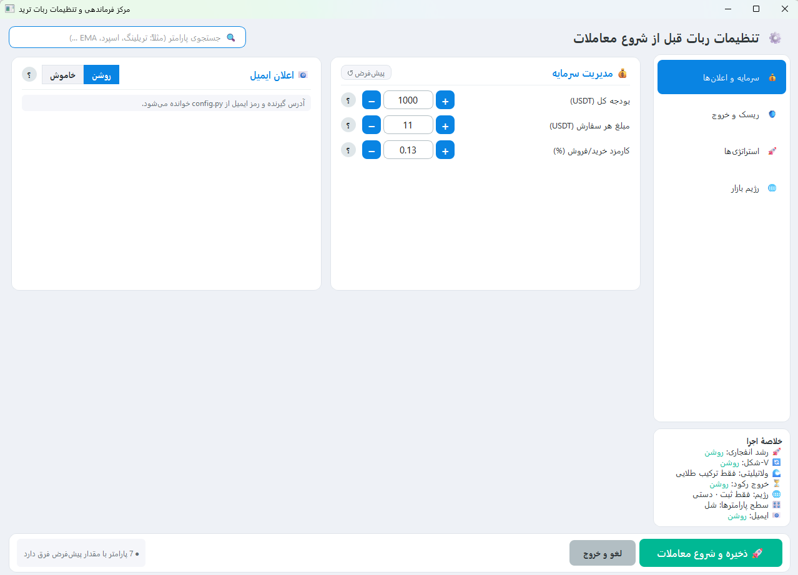

<div align="center">

# 📈 Real-Time Crypto Trading Simulation System

### Automated Signal-Driven Trading Simulator & Multi-Module Execution Terminal

**An independently engineered Python trading simulation system that ingests real-time signals from KuCoin and simulates order execution using live Nobitex Ask/Bid prices, trading fees, risk rules, and AI-assisted market analysis.**

[](https://python.org)
[](#core-capabilities)
[](#core-capabilities)
[](#core-capabilities)

</div>

---

## 📌 About the Project

**Real-Time Crypto Trading Simulation System** is an independently built trading simulation and monitoring platform.

It listens to market data and generates signals from **KuCoin**, simulates buy/sell trades using live **Nobitex Ask/Bid prices**, deducts **buy/sell fees**, applies spread and market-quality filters, and provides pre-session configuration along with an AI market advisor.

> **Disclaimer:** Built strictly for simulation, strategy analysis, and portfolio showcase purposes. Not financial advice and does not guarantee trading results.

---

## 🖥️ Application Preview

### ⚙️ Pre-Session Command & Configuration Center


### 📊 Trading Terminal & Live Positions


### 📈 Strategy Evaluation


### 🤖 AI Advisor & Market Chat


---

## 🧩 Core Capabilities

- **Pre-Session Configuration Center:** Configure total budget, order size, buy/sell fee percentage, risk/exit rules, signal strategies, and market regimes before starting a session.
- **Configurable Signal Strategies:** Support for multiple signal-generation strategies with side-by-side strategy evaluation.
- **Real-Time Simulation Engine:** Uses live KuCoin signals and simulates fills against real Nobitex Ask/Bid prices with fee deduction and net P&L tracking.
- **Risk & Live Terminal Controls:** Tracks open/closed positions, win rate, realized/unrealized P&L, quick trading toggle, and emergency position liquidation.
- **AI Advisor & Market Chat:** Interactive analytical assistant with multi-provider LLM routing, market context, and trade/position insights.

---

## 🏗️ System Flow

```mermaid
flowchart LR
    A[KuCoin Market Signals] --> B[Strategies & Regime/Spread Filters]
    B --> C[Simulation Engine]
    D[Nobitex Live Ask/Bid + Fees] --> C
    C --> E[Positions, Logs & Reports]
    C --> F[Trading Terminal UI]
    E --> G[AI Advisor Chat]
