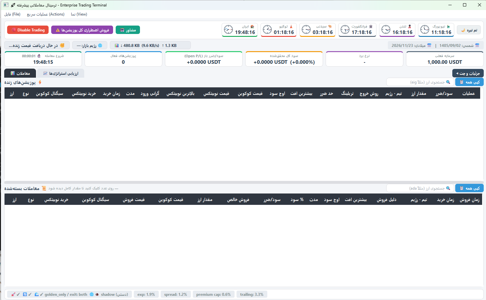
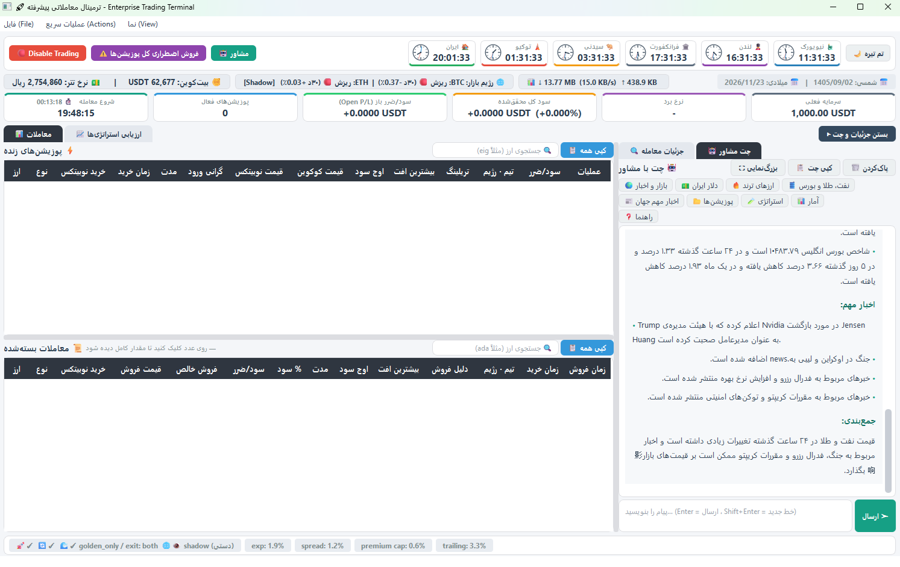

<div align="center">

# 📈 Real-Time Crypto Trading Simulation System

### Modular Signal-Driven Trading Simulator & Execution-Ready Terminal

**An independently engineered Python trading platform that ingests real-time market signals, simulates order execution with live Ask/Bid pricing and fee modeling, and features a decoupled architecture ready for live exchange integration.**

[](https://python.org)
[](#system-architecture)
[](#core-capabilities)
[](#core-capabilities)

</div>

---

## 📌 About the Project

**Real-Time Crypto Trading Simulation System** is a full-featured desktop trading terminal and simulation engine built in Python.

Designed around a decoupled data, strategy, and execution architecture, the platform processes real-time market signals, enforces configurable risk and market-regime rules, and simulates realistic fills using live Ask/Bid spreads and fee structures—while keeping the execution layer modular enough to plug directly into live exchange APIs.

> **Disclaimer:** This repository presents a visual and architectural overview for portfolio and technical showcase purposes. It does not constitute financial advice or guarantee trading performance.

---

## 🖥️ Application Preview

### ⚙️ Pre-Session Command & Configuration Center


### 📊 Enterprise Trading Terminal & Live Monitoring


### 🤖 AI Market Advisor & Trade Insights


---

## 🧩 Core Capabilities

- **Pre-Session Configuration Center:** Full control over capital allocation, per-order sizing, trading fee modeling, risk/exit rules, strategy selection, and market regime settings prior to starting a session.
- **Pluggable Strategy & Regime Layer:** Supports multiple configurable signal-generation strategies alongside market-quality, spread, and regime filtering—without exposing proprietary strategy internals.
- **Realistic Execution Simulation:** Evaluates live Ask/Bid pricing, entry/exit slippage sensitivity, fee deductions, and real-time open/closed P&L tracking.
- **Live Exchange-Ready Architecture:** Built with isolated exchange adapter and order-routing interfaces so live exchange order execution can be enabled seamlessly with minimal changes to core trading logic.
- **Real-Time Terminal & Risk Controls:** Multi-session global clocks, live network/feed telemetry, active and closed position ledgers, strategy performance evaluation, trading kill-switch, and emergency position exit controls.
- **AI Advisor & Market Assistant:** Integrated analytical assistant providing context-aware market summaries, position diagnostics, and multi-provider LLM routing.

---

## 🏗️ System Architecture

The system separates market signal ingestion, decision filtering, and execution adapters so simulation and live exchange connectors share the same core pipeline:

```mermaid
flowchart LR
    A[Market Data & Signal Feeds] --> B[Configurable Strategy & Regime Engine]
    B --> C[Risk, Spread & Quality Filters]
    C --> D[Execution Adapter Interface]
    D --> E[Simulation Engine: Live Ask/Bid + Fees]
    D -.-> F[Live Exchange API Connector]
    E --> G[Trading Terminal, Logs & Telemetry]
    G --> H[AI Advisor & Market Chat]
